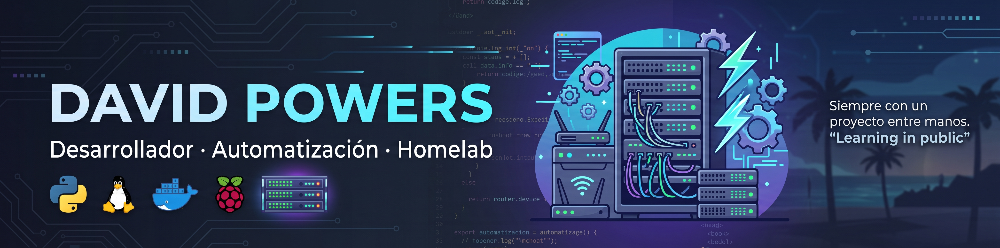
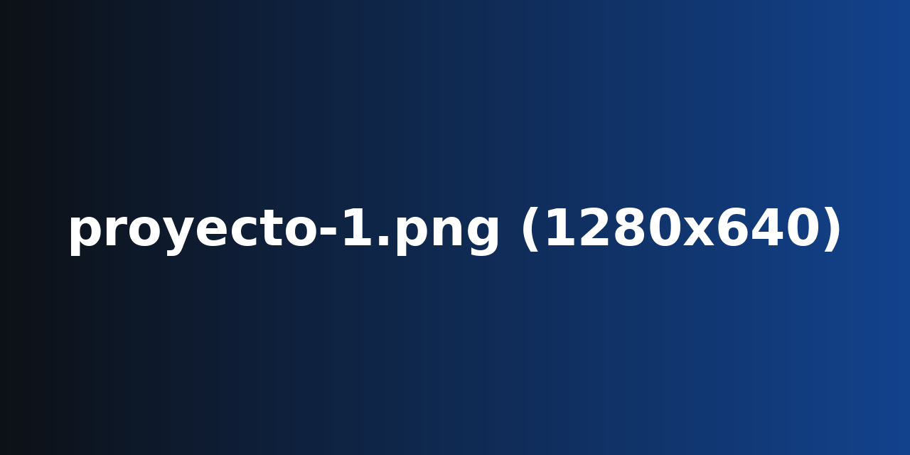
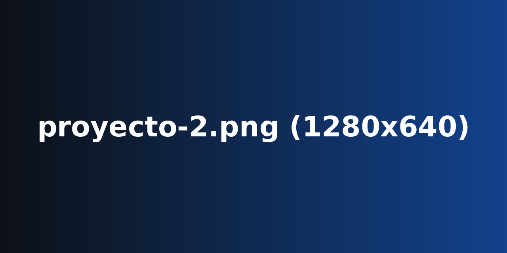
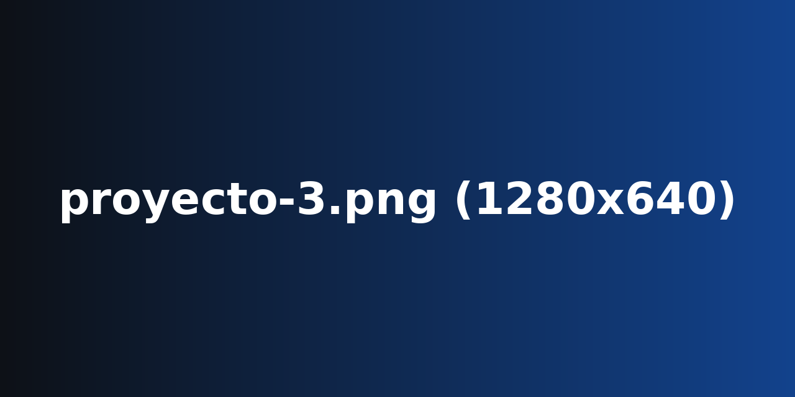

<!-- ============================================================
  PERFIL DE GITHUB · CotPowers
  Para personalizar solo necesitas SUSTITUIR las imágenes de /assets
  (mismo nombre de archivo):
    Banner.jpg     1280x320   cabecera
    avatar.png     400x400    foto / logo
    proyecto-1.png 1280x640   banner del proyecto 1
    proyecto-2.png 1280x640   banner del proyecto 2
    proyecto-3.png 1280x640   banner del proyecto 3
============================================================ -->

# Hola, soy David 👋
### Desarrollador en formación · Python · Homelab · Automatización

Vivo en San Vicente del Raspeig (Alicante, España). Estoy aprendiendo y construyendo en público: Python, aplicaciones web, y mi propio laboratorio doméstico con servidores, redes y automatizaciones.

> 🚀 Siempre con un proyecto entre manos: me gusta automatizar lo repetitivo y entender cómo funcionan las cosas por dentro.

## Encuéntrame en

## Tecnologías con las que trabajo

  

  

## Proyectos destacados

### 🐍 Python Para Todos

### 🧩 Proyecto 2

<!-- Cambia el enlace y el nombre del repo cuando lo tengas -->

### 🏠 Proyecto 3

## Estadísticas de GitHub

  
  

  

---

⭐ Si algo de lo que hago te sirve, una estrella siempre se agradece.

